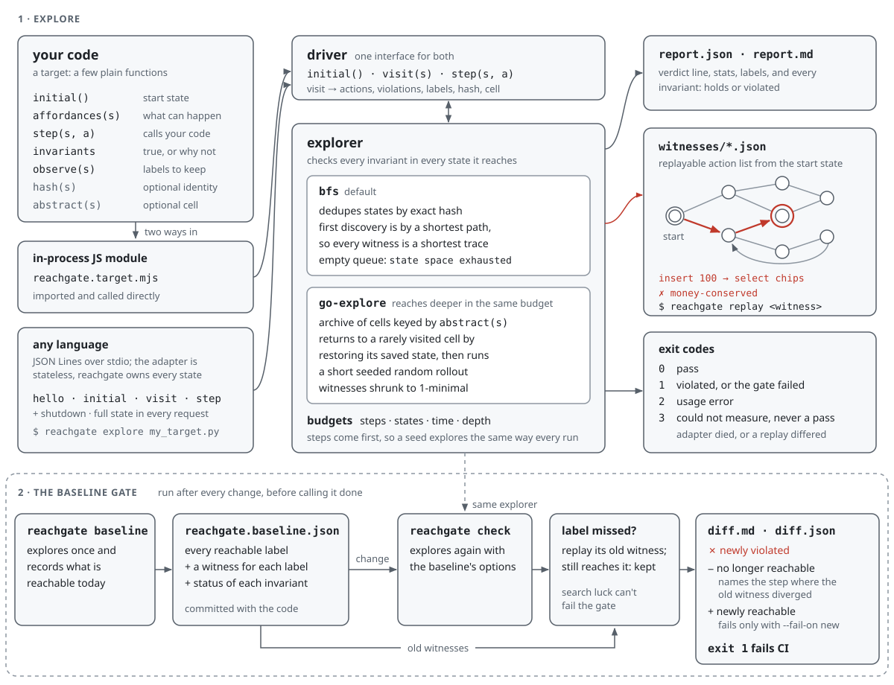
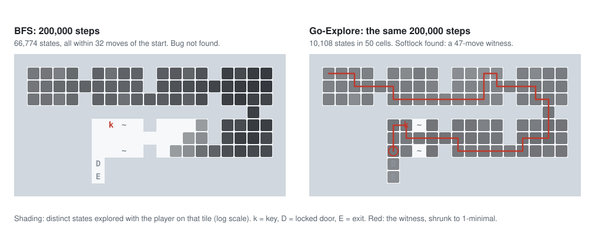

<p align="center"></p>

# reachgate

**Explore every reachable state of your real code, check invariants in each one, and get the shortest
replayable trace to every violation. Then gate changes against a behaviour baseline: `reachgate check`
says what became reachable or unreachable before you, or your coding agent, call a change done.**

- **Runs your code, not a model of it.** You describe it with three functions: `initial()`,
  `affordances(state)` and `step(state, action)`. Those call your real reducer, engine or service.
- **Witnesses you can replay.** Each violation comes with a list of actions from the start state. With
  BFS it is the *shortest* such list. Every witness is replayed twice before it is reported.
- **A baseline gate that isn't flaky.** reachgate records which behaviour is reachable, with a witness
  for each. After a change, it says what is newly reachable, what is no longer reachable, and at which
  step the old trace diverged. Old witnesses are replayed first, so search luck never fails the gate.
- **Made for agents and CI.** JSON and Markdown reports, documented exit codes, an agent skill, zero
  runtime dependencies. Any language plugs in through a small JSON-over-stdio protocol; a Python
  helper is included.

<p align="center"></p>

## Install

```bash
npm install -g github:vulbsti/reachgate
```

Once the package is published to npm (not yet), this becomes `npm install -g reachgate`.

Or from a clone: `git clone https://github.com/vulbsti/reachgate && npm install -g ./reachgate`. That
links the clone, so keep it. Once the package is on npm, `npx reachgate ...` works without installing.

**Supported:** Node.js 20 or newer on Linux (tested in CI on Node 20 and 22). macOS is in the CI
matrix too, but its runners haven't run on the private repo yet, so treat it as untested for now; there
are no native dependencies. Windows is untested. Python 3.9+ for Python targets.

## Quickstart

Run it on a bundled example. This is a small dungeon game with a seeded softlock bug, run from a clone
of this repo:

```console
$ reachgate explore examples/dungeon/target.mjs
FAIL: 1 invariant violated · 10772 states, 35881 steps, 18 labels · state space exhausted · 505 ms
  ✗ no-softlock: the exit can no longer be reached: the key is stuck in the locked door at (8,4)
    witness (13 steps, shortest): down → right → right → right → right → right → right → up → right → down → down → up → wait
    replay: reachgate replay examples/dungeon/target.mjs .reachgate/witnesses/no-softlock.json
warning: 16 state(s) that violate an invariant were not explored further, so the invariants reported as holding were only checked on the other states. Fix the violations, or rerun with --expand-violations to check past them.
report: .reachgate/report.md
```

Then wire in your own project. [The 15-minute guide](docs/wire-in-15-minutes.md) walks a real one,
from start to finish:

```bash
reachgate init                 # or: reachgate init --lang python
# edit reachgate.target.mjs: point initial/affordances/step at your code, add invariants
reachgate inspect              # check the wiring
reachgate explore              # find violations, with shortest witnesses
reachgate baseline             # record reachable behaviour; commit reachgate.baseline.json
reachgate check                # after every change: the gate (exit 1 = something got worse)
```

A target is a plain object:

```js
import { createMachine, insert, select, refund } from './src/vending.js';

export default {
  initial: () => ({ m: createMachine(), inserted: 0 }),
  affordances: ({ m, inserted }) => [
    ...(inserted < 400 ? [{ type: 'insert', coin: 50 }, { type: 'insert', coin: 100 }] : []),
    { type: 'select', item: 'cola' }, { type: 'select', item: 'chips' },
    ...(m.credit > 0 ? [{ type: 'refund' }] : []),
  ],
  step: (s, a) => { /* call your real insert/select/refund */ return s; },
  invariants: {
    'money-conserved': ({ m, inserted }) => m.cashbox + m.credit + m.returned === inserted || 'money appeared or vanished',
  },
  observe: ({ m }) => m.dispensed.map((d) => `dispensed:${d}`), // behaviour the baseline keeps reachable
};
```

## How it works

<picture>
  <source media="(prefers-color-scheme: dark)" srcset="assets/architecture-dark.svg">
  
</picture>

1. **Explore.** reachgate starts at `initial()`, asks `affordances(s)` what can happen next, and
   applies each action with `step(s, a)`. It checks every invariant in every state it reaches.
2. **Witness.** For each violated invariant it keeps the shortest trace that reached it. It replays
   the trace twice from the start to prove it reproduces. If a replay doesn't reproduce, the target
   has hidden state (a clock, randomness or a module-level variable), and reachgate exits 3 rather
   than report a bug it can't show.
3. **Gate.** `reachgate baseline` records every reachable label (from `observe(s)`, plus every action
   ever offered) with a witness, and the status of every invariant. `reachgate check` explores
   again and writes `.reachgate/diff.md`:

```
**FAIL: 2 label(s) no longer reachable.**

- `action:redo`: the baseline witness still replays (2 step(s)), but at its end "redo" is no longer
  offered; offered there now: add, setFilter active, setFilter done, undo.
  Baseline witness: add → undo (`.reachgate/witnesses/lost_action_redo.json`)
```

That is the [todo-reducer example](examples/todo-reducer/). A refactor silently stopped offering redo.
Every invariant still holds, so only the baseline notices.

### Two strategies

- **`bfs`** (the default) visits states in order of distance from the start. Its witnesses are
  **shortest**. When the queue empties, the report says `state space exhausted`: every reachable
  state was checked, not a sample.
- **`--strategy go-explore`** keeps an archive of coarse *cells* (your `abstract(s)`), returns to rarely
  visited ones by restoring their saved state, and explores from there with short seeded rollouts. It
  reaches deep states that BFS can't cover in the same budget. Its witnesses are shrunk until no
  single step can be removed (1-minimal), but they are not claimed to be shortest.

<picture>
  <source media="(prefers-color-scheme: dark)" srcset="assets/explore-coverage-dark.svg">
  
</picture>

These are real runs on the [dungeon example](examples/dungeon/)'s `#deep` level, with the same
200,000-step budget for both strategies. All five seeds tried (1-5) find the bug with Go-Explore.
BFS doesn't find it even with 2,000,000 steps.

Budgets are counted in **steps** (`--max-steps`, `--max-states`, `--max-depth`), so the same seed always
explores the same way. Time (`--max-seconds`) is only a safety cap, and a run stopped by it is flagged
as not reproducible. Add `--require-exhaustive` in CI when the scenario should be finite. A search
that stopped on a budget then exits 3, not 0.

## Examples

Each example is ordinary application code with a realistic seeded bug, a fixed variant, a README, and
a test that pins the witness length.

| Example | What it is | Seeded bug | Shortest witness | Fixed variant |
| --- | --- | --- | --- | --- |
| [dungeon](examples/dungeon/) | turn-based game engine (JS) | a knocked-loose key can skid into the locked door: a softlock | 13 moves | 11,306 states, exhaustive |
| [todo-reducer](examples/todo-reducer/) | Redux-style UI reducer with undo/redo (JS) | redo restores items without re-checking the selection | 5 actions | 25,465 states, exhaustive; plus a `regressed` variant only the baseline catches |
| [auth-session](examples/auth-session/) | login, 2FA, lockout, reset tokens (JS) | a remembered-device shortcut runs before the lockout check | 7 actions | 2,457 states, exhaustive |
| [checkout-py](examples/checkout-py/) | checkout with a flaky payment provider (**Python**, via the adapter) | a retry after a timeout uses a new idempotency key: a double charge | 6 actions | 1,170 states, exhaustive |

## Benchmarks

Medians of 3 runs of the real CLI on a 16-core laptop (AMD Ryzen AI 7 PRO 350, Node 26, while other jobs were running). Full table, method and machine details are in
[docs/benchmarks.md](docs/benchmarks.md).

| Example | States explored | Time to first violation | Total time | Peak memory |
| --- | ---: | ---: | ---: | ---: |
| dungeon (BFS) | 10,772 (exhaustive) | 54 ms | 0.43 s | 105 MB |
| dungeon `#deep` (BFS, 200k steps) | 66,774 (budget) | not found | 3.81 s | 204 MB |
| dungeon `#deep` (Go-Explore, 200k steps, seeds 1-5) | 9,248-12,794 (budget) | 1.0-1.9 s | 3.7-7.3 s | 81-85 MB |
| todo-reducer (BFS) | 27,049 (exhaustive) | 44 ms | 2.50 s | 151 MB |
| auth-session (BFS) | 2,688 (exhaustive) | 50 ms | 0.31 s | 84 MB |
| checkout-py (BFS, Python adapter) | 4,290 (exhaustive) | 176 ms | 0.78 s | 83 MB Node + 13 MB Python |

State counts are exact and deterministic. Times and memory depend on the machine. The weak spot:
the Python adapter costs two JSON round trips per transition. Batching them is on the [roadmap](docs/ROADMAP.md).

## For coding agents

reachgate ships an agent skill ([`skills/reachgate/SKILL.md`](skills/reachgate/SKILL.md)). It tells an
agent when to run `reachgate check`, how to read the diff, and when re-recording the baseline is
legitimate. In Claude Code:

```
/plugin marketplace add vulbsti/reachgate
/plugin install reachgate@reachgate
```

For any agent, add this to `CLAUDE.md` / `AGENTS.md`:

```markdown
## Before calling a change done
`reachgate check` must pass. Quote its verdict line in the PR. If behaviour was removed on purpose,
say why and run `reachgate baseline` to accept it. Never edit reachgate.baseline.json by hand.
```

### Exit codes

| Code | Meaning |
| --- | --- |
| 0 | pass: no invariant violated, or nothing got worse than the baseline |
| 1 | fail: an invariant is violated (`explore`), or a regression against the baseline (`check`) |
| 2 | usage or config error |
| 3 | could not measure: `initial()` threw, the adapter died, a witness didn't replay deterministically, or `--require-exhaustive` and the search stopped on a budget |

`reachgate replay` uses the same scale: 0 when the witness reproduces its violation (or reaches its
label), 1 when it replays but the violation no longer happens (fixed?), and 3 when it no longer replays
(a step stopped being offered).

Reports go to `.reachgate/` (`report.json`, `report.md`, `diff.json`, `diff.md`, `witnesses/*.json`).
See the [CLI reference](docs/cli.md).

## Other languages

Targets in any language run as a child process speaking [JSON Lines over stdio](docs/protocol.md): five
methods (`hello`, `initial`, `visit`, `step`, `shutdown`). The adapter is stateless: reachgate sends the full state
each time, so Go-Explore can restore any state with no snapshot API in your language. For Python,
`reachgate init --lang python` drops in a zero-dependency helper:

```python
from reachgate_adapter import serve
serve(name="checkout", initial=initial, affordances=affordances, step=step,
      invariants={"single-capture": lambda s: s["captures"] <= 1})
```

```bash
reachgate explore my_target.py          # or: reachgate explore --cmd "ruby my_target.rb"
```

## Alternatives

reachgate borrows from model checkers and property-based testing, and is weaker than each of them in
their own domain. Details and sources are in [docs/alternatives.md](docs/alternatives.md).

| If you need | Consider |
| --- | --- |
| rich generated data with excellent shrinking | [fast-check](https://fast-check.dev) `fc.commands` (JS), [Hypothesis](https://hypothesis.readthedocs.io/en/latest/stateful.html) stateful testing (Python) |
| liveness and temporal properties, or checking a design before code exists | [TLA+ / TLC](https://lamport.azurewebsites.net/tla/tools.html) |
| symbolic checking of state spaces too large to enumerate | [Apalache](https://apalache-mc.org/) |
| byte-level inputs: parsers, decoders | coverage-guided fuzzers (libFuzzer, AFL++, Jazzer.js, Atheris) |
| an app that is already an XState machine | [`xstate/graph`](https://stately.ai/docs/graph) path generation |
| Rust | [Stateright](https://github.com/stateright/stateright): nearly the same `Model` interface, more checkers |

What reachgate adds is narrow: it explores your real code (not a spec), keeps runs deterministic within
step budgets, returns shortest or 1-minimal replayable witnesses, and keeps a reachable-behaviour
baseline that replays old witnesses before calling anything lost. None of the tools above diff
reachable behaviour across code changes; that gate is the point.

## Limits

- **Explicit-state only.** It enumerates concrete states. Keep value domains small (two or three IDs,
  quantity caps), or use Go-Explore and accept a sample. The report always says which you got.
- **Invariants and deadlock only.** It has no temporal-logic liveness checking.
- **State must be cloneable.** In-process targets use `structuredClone` (or your `clone`), and
  adapter targets use JSON. `step` must be deterministic: inject clocks and randomness into the state.
- **Single-threaded.** Parallel BFS is on the [roadmap](docs/ROADMAP.md).

## Docs

[Wire your project in 15 minutes](docs/wire-in-15-minutes.md) ·
[CLI reference](docs/cli.md) · [Adapter protocol](docs/protocol.md) · [Architecture](docs/architecture.md) ·
[Benchmarks](docs/benchmarks.md) · [Alternatives](docs/alternatives.md) · [Roadmap](docs/ROADMAP.md) ·
[Decisions](DECISIONS.md) · [AGENTS.md](AGENTS.md)

## Origin

reachgate generalises a verifier first written for a browser game. That verifier explored the game's
real rules engine with Go-Explore, kept the shortest replayable trace to everything it found, and
failed the build when anything got worse than a recorded baseline. Coding agents had to pass it before
calling a change done. The same idea of verifying by measurement, instead of trusting a reviewer,
works for any code whose behaviour you can describe as states and actions. None of the game's code or
content is included here.

## Contributing and license

See [CONTRIBUTING.md](CONTRIBUTING.md), [CODE_OF_CONDUCT.md](CODE_OF_CONDUCT.md) and
[SECURITY.md](SECURITY.md). Licensed under [Apache-2.0](LICENSE).
