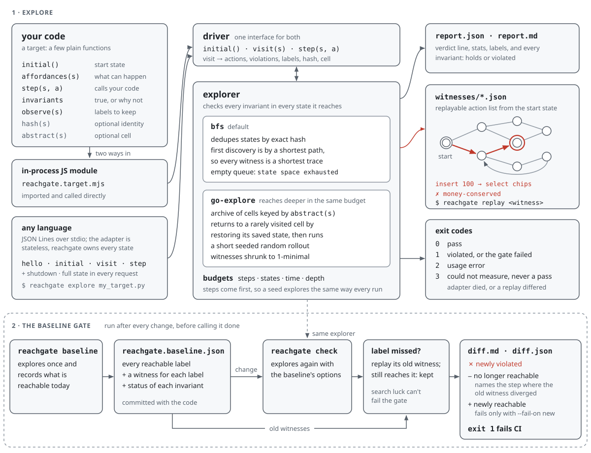

# Architecture

reachgate is about 1,300 lines of dependency-free Node.js. Each module has one job:

| Module | Job |
| --- | --- |
| `src/target.mjs` | Defines the target interface and wraps an in-process target as a **driver**: `visit(s)` returns actions, violations, labels, hash and cell in one call; `step(s, a)` returns the next state or a crash. |
| `src/adapter.mjs` | The same driver interface over a child process speaking [JSON Lines](protocol.md). The adapter is stateless: the full state travels with every request. |
| `src/load.mjs` | Turns `file.mjs`, `file.mjs#export`, `file.py`, `--cmd` or the config file into a driver. |
| `src/explore.mjs` | BFS and Go-Explore over a driver, with budgets, and a recorder that keeps the shortest search node per invariant and per label. |
| `src/replay.mjs` | Replays a trace, refusing any action `affordances()` doesn't offer at that point, and `shrink()`s it (loop cutting, then ddmin). |
| `src/baseline.mjs` | Builds the signature, compares a new run against a baseline, and diagnoses why each lost label was lost. |
| `src/report.mjs` | Writes the JSON report, Markdown report and diff, witness files and exit codes. |
| `src/cli.mjs` | Argument parsing and the six commands. |
| `src/canonical.mjs` | Canonical JSON (sorted keys) and SHA-1 digests. The same state hashes the same in every language. |



## Design choices, and why

**Real code, not a model.** The game verifier reachgate grew out of ran on the game's real rules engine, so it couldn't drift
from the game. reachgate keeps that rule: the target's hooks call your code. The price is that the state
must be cloneable (`structuredClone` in-process, JSON through the adapter), and that `step` must be
deterministic. reachgate checks determinism by replaying every witness twice.

**Branch on decisions, not ticks.** `affordances(s)` lists what can happen next: user input, timers,
network replies. Modelling the environment as actions is what lets a protocol example explore "the
payment provider times out, then the user retries".

**Two identities.** `hash(s)` is exact identity, and BFS dedupes on it. `abstract(s)` is a coarse cell,
and Go-Explore archives on it. One hook can't serve both: BFS needs exactness to be exhaustive and
shortest, and Go-Explore needs coarseness to make progress in a large space.

**BFS memory.** Search nodes keep only `{parent, action, depth}`. States live only in the frontier
queue, so memory is one small node per visited state, plus the frontier's states. Traces are rebuilt
from parent pointers at the end.

**Go-Explore selection.** A cell is picked with weight `1/sqrt(1 + visits)`, the count-based rule from
Ecoffet et al. It is sampled by rejection, so each pick is O(1) however large the archive. Within a
rollout, actions tried least anywhere in the search are preferred (from the original verifier). A cell keeps
the shortest node that reached it.

**Steps are the budget.** Time is only a safety cap. The same seed and step budget explore the same
states in the same order, so two runs of `check` on unchanged code agree.

**Witnesses are proven, not trusted.** Every violation's witness is replayed twice from `initial()`
before it is reported. A replay that doesn't reproduce means hidden state in the target, and the run
exits 3 rather than reporting a bug it can't show.

**The gate replays before it blames.** A baseline stores one witness per label. When a new search
misses a label, the old witness is replayed first. The label is only reported lost if the witness
can't reach it, and the diff then says why:

- the step where an action stopped being offered (with what is offered instead),
- the step that now throws, or
- that the whole trace still replays but the label never shows up along it.

Without this, a budget-limited search would make the gate flaky. The original game verifier introduced the trick.

## Data flow

```
target ──► driver ──► explore (bfs | go-explore) ──► recorder ──► witnesses (replayed ×2, shrunk)
                                                                   │
                         report.json / report.md / witnesses/*.json ◄┘
                                                                   │
           baseline: signature(result) ──► reachgate.baseline.json │
           check:    compare(baseline, result) ── replay old witnesses ──► diff.json / diff.md ──► exit code
```

## What reachgate is not

- Not symbolic: it enumerates concrete states. A state space too large to enumerate needs a coarser
  scenario (smaller domains) or Go-Explore, and then the result is a sample, which the report says.
- No temporal logic: no liveness (`eventually`) properties. Deadlock detection (`isTerminal`) and
  invariants that read ghost variables cover common cases. Real liveness checking belongs to TLC or
  Stateright (see [alternatives](alternatives.md)).
- Single-threaded: one target, one process. See the [roadmap](ROADMAP.md).
